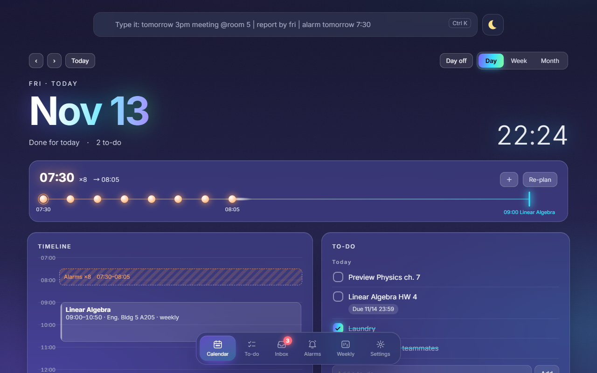
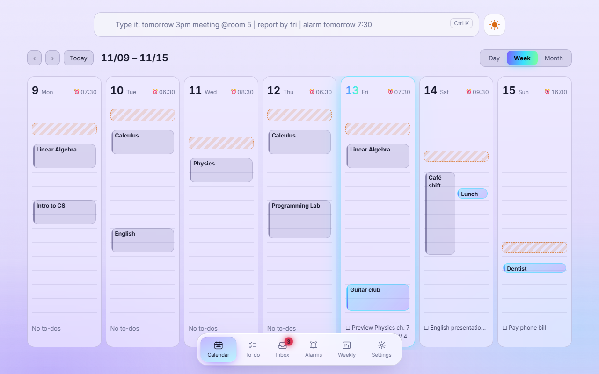
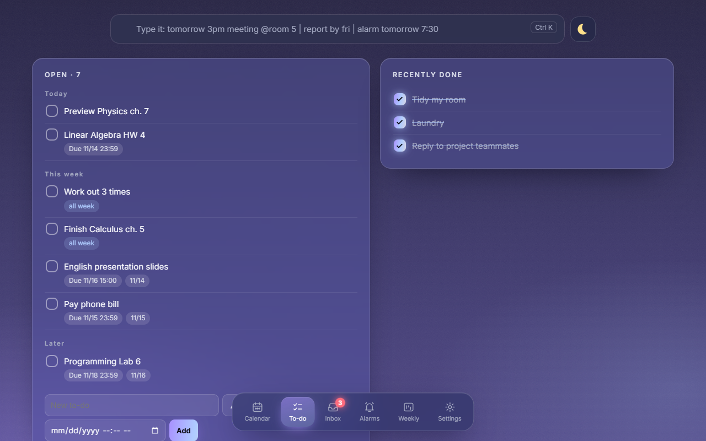
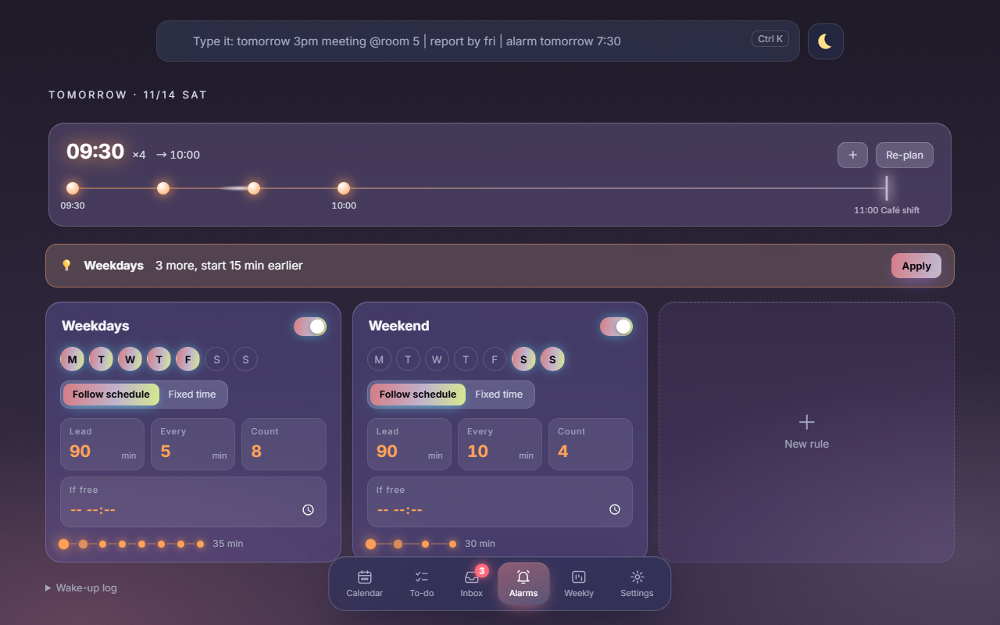
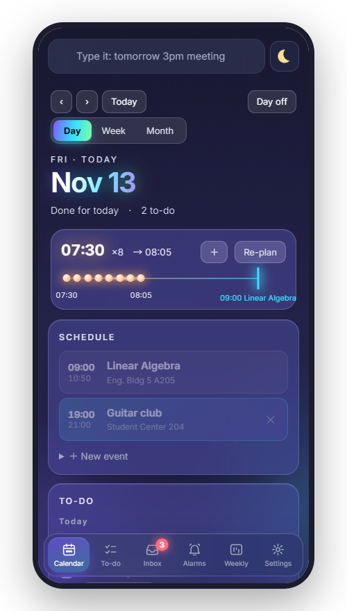

# Asa

**Self-hosted alarms that plan themselves.** Asa looks at tomorrow's schedule every evening and sets a whole batch of wake-up alarms for you — earlier when your first event is earlier, none when you have the day off. A calendar, daily/weekly to-dos and a review inbox for things pulled from other systems are built in.

> English / 繁體中文 UI, light and dark themes. 中文說明：[README.zh-TW.md](README.zh-TW.md)



| Week view, light theme | To-dos | Alarm rules | Phone |
|---|---|---|---|
|  |  |  |  |

**Try it with sample data** — no setup, your own data is untouched:

```bash
ASA_DEMO=1 ./run.sh        # Windows: set ASA_DEMO=1 && run.bat
```

## Features

- **Auto alarms** — rules like "weekdays: start 90 min before the first event, 8 alarms, 5 min apart". Re-planned whenever your schedule changes.
- **Android companion app** — rings on its own (no internet needed once synced), full-screen on the lock screen, rising volume, a maths question before "I'm up", reports wake-up times back.
- **Habit learning** — after a few mornings it suggests rule changes ("you sleep through the first 3, start later and ring more often").
- **Calendar** — day / week / month views, weekly recurring events, days off.
- **Couples and families** — add a member in Settings and each person gets their own alarms, to-dos, notifications and access code. Events and to-dos can be marked *shared*; a shared 9 am event moves both people's alarms, each by their own rule. No accounts or passwords, and nothing changes if you use it alone.
- **Wake each other up** — members see whether the other person is up yet. If you are still asleep N minutes after your last alarm, the others get a push; one tap on *Wake them* makes your phone ring at full volume (Android app) or sends an urgent push (ntfy and others). Tap *I'm up* in the app or on the web and they know.
- **Commute-aware alarms** — set your home address and how long it takes to reach your usual places; alarms move earlier by the travel time to the event's location, plus extra when rain is forecast (Open-Meteo). Unknown places can be estimated with OpenStreetMap (no live traffic or public transit).
- **No Android phone?** — a member can be woken by push notification instead of the app (works on iPhone through ntfy, Telegram, LINE or Discord), and anyone can get a push N minutes before each event.
- **Typhoon days (Taiwan)** — set `CLOSURE_AREA` and Asa watches the government closure notices; when classes are cancelled it marks the day off, drops the alarms and tells you.
- **To-dos** — per day and per week, deadlines shown on the calendar, a 14-day load chart.
- **One-line input** (`Ctrl+K`) — `tomorrow 3pm meeting @room 5`, `report by fri`, `alarm tomorrow 7:30`, `every tue 9:10-12:00 calculus` (English or Chinese).
- **Looks** — animated aurora background, 21 colour palettes (one per page, pick one, or random), light/dark toggle, phone-friendly layout.
- **Review inbox** — sources drop items in; nothing reaches your calendar until you approve it.
  - iCalendar feeds (Google Calendar, Outlook, Moodle, Canvas, …), including repeating events
  - trust a source? `AUTO_APPROVE=ics` skips the review step for it
  - eeClass LMS (used by many universities in Taiwan)
  - anything else: `POST /api/inbox`, or write a ~30-line plugin in `app/sources/`
- **Notifications** — Discord, LINE, Telegram, ntfy, or any webhook: evening preview, morning brief, new inbox items.

## Quick start

Needs Python 3.11+.

```bash
git clone https://github.com/mintguesss/asa && cd asa
cp .env.example .env      # optional — everything works with an empty .env
./run.sh                  # Windows: run.bat
```

Open <http://localhost:8787>. The first start creates the virtualenv, the database (`data/asa.db`) and an access code for other devices (`PHONE_TOKEN` in `.env`).

### Docker

```bash
cp .env.example .env
docker compose up -d
```

Set your time zone in `docker-compose.yml` (alarm times are local times), then open `http://localhost:8787/?token=<PHONE_TOKEN from .env>`. Set `PUBLIC_URL` in `.env` so links in notifications and the phone setup page point at the host, not the container.

### Install as an app (PWA)

Browsers only install web apps served over HTTPS. With Tailscale, one command gives you an HTTPS address that only your own devices can reach:

```bash
tailscale serve --bg --https=8443 http://localhost:8787
```

Then open `https://<your-machine>.<tailnet>.ts.net:8443` on the phone, enter the access code once, and use *Install app* (Android) or *Share → Add to Home Screen* (iPhone). Set `PUBLIC_URL` in `.env` to that address so notification links use it.

### Start with Windows

Run `install_autostart.bat` (asks for administrator rights once). It registers a Task Scheduler task that starts Asa in the background at boot — before login, no console window, restarted if it crashes, no password stored. `uninstall_autostart.bat` removes it.

### Access

Requests from the same machine are trusted; every other device must send the access code (`?token=…` once in the browser, or the `X-Token` header). Don't expose the port to the public internet — use your LAN or a private network such as Tailscale.

## Android app

Source is in `android/` (Kotlin, no third-party dependencies, minSdk 26). Build with Android Studio, or on Windows run `android\build_apk.bat`, which downloads a JDK, Gradle and the Android SDK into a separate folder and produces `android/AsaAlarm.apk`. Then enter the server URL and access code shown on the Settings page.

## Configuration

Everything lives in `.env` — see [.env.example](.env.example). Restart after changing it.

Any page can be linked directly, and preferences can be overridden per link: `/?view=week&theme=light&lang=en&pal=lilac&date=2026-01-31` (`view`: day, week, month, tasks, inbox, alarms, weekly, link).

## Adding a source or a notification channel

- **Source**: add a module to `app/sources/` exposing `NAME`, `LABEL`, `ENV`, `configured()` and `collect()`, and list it in `app/sources/__init__.py` (the docstring there describes the item format).
- **Language**: UI strings are in `app/static/i18n.js`, server strings in `app/i18n.py` (set `ASA_LANG` for push messages).
- **Channel**: add a function and one line to `CHANNELS` in `app/notify.py`.

## Stack

FastAPI · SQLite · APScheduler · vanilla JS/CSS (no build step).

## Status

Early. The Android app builds, and the Docker image builds and starts, but the app has not been tested on many devices. The eeClass source has not been verified against a real account, and the closure detection has only been tested against the page's no-closure state plus simulated notices — issues and PRs welcome.

## Credits

The aurora background and glowing card border are ported from [React Bits](https://reactbits.dev) by David Haz (MIT + Commons Clause); see `app/static/vendor/`. The checkbox is modelled on its SpringCheck. The sun/moon toggle is adapted from Adam Argyle's Theme Switch (GUI Challenges, Apache-2.0); the circular reveal follows Magic UI's Animated Theme Toggler (MIT).

## License

MIT — see [LICENSE](LICENSE). Bundled third-party pieces keep their own licenses: [THIRD_PARTY_NOTICES.md](THIRD_PARTY_NOTICES.md).
