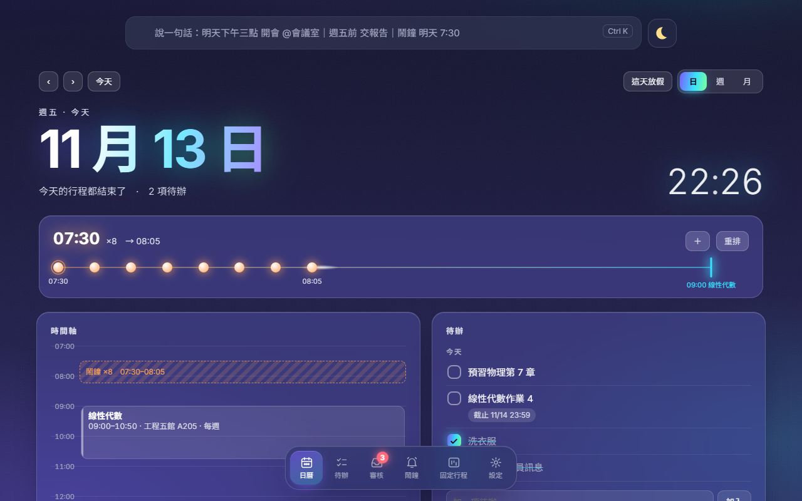
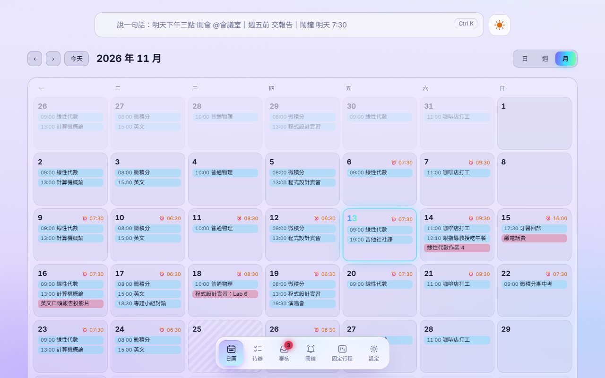
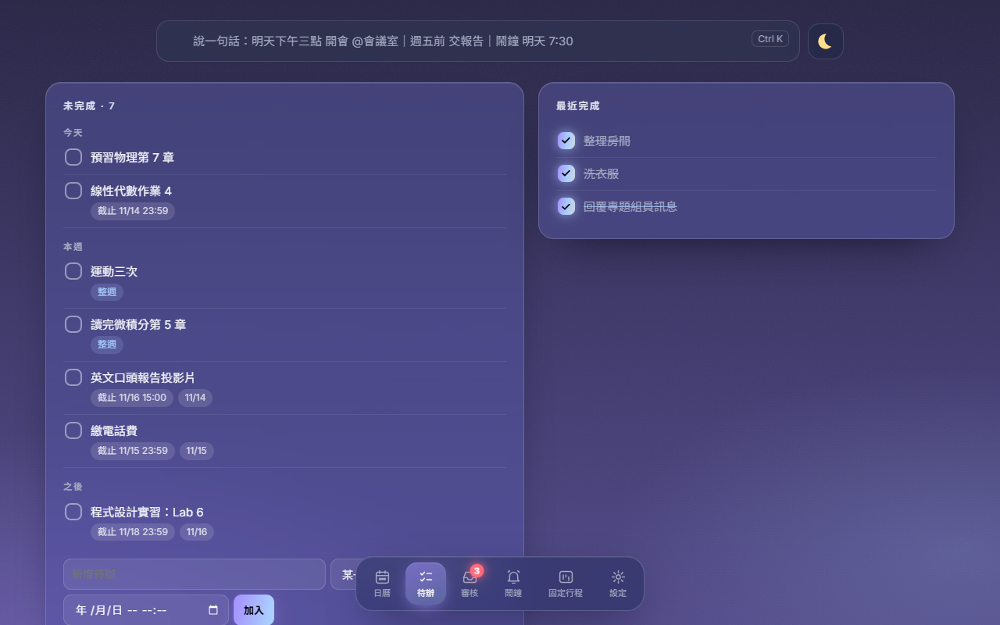
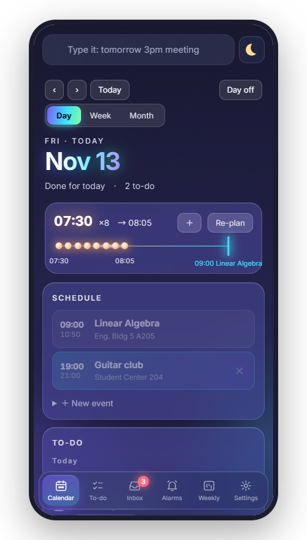

# Asa

**會自己排的鬧鐘。** 每天晚上依照明天的行程，自動幫你設好一整組起床鬧鐘：第一個行程早就早響，放假就不響。內建行事曆、每日／每週待辦，以及從其他系統抓資料、審核後才進來的收件匣。



| 月檢視（亮色） | 待辦（淺紫） | 手機 |
|---|---|---|
|  |  |  |

## 啟動

需要 Python 3.11 以上。

- Windows：雙擊 `run.bat`
- macOS / Linux：`./run.sh`

然後開 <http://localhost:8787>。第一次啟動會自動建立虛擬環境、資料庫（`data/asa.db`）和給其他裝置用的存取碼（`.env` 裡的 `PHONE_TOKEN`）。

- 設定都在 `.env`（範本是 `.env.example`），全部都可以留空，改完要重新啟動。
- 這台電腦直接放行；其他裝置要帶存取碼（瀏覽器網址加一次 `?token=…`）。
- 第一次啟動時 Windows 防火牆會問要不要允許 Python 連線，要允許手機才連得到。
- 不要把這個埠直接開到公開網路，用區網或 Tailscale 這類私人網路。

**先用範例資料試玩**：啟動前設 `ASA_DEMO=1`（Windows：`set ASA_DEMO=1 && run.bat`；macOS / Linux：`ASA_DEMO=1 ./run.sh`）。會用獨立的 `data/demo.db`，不會動到你的資料，也不會發通知。

**Docker**：`cp .env.example .env` 之後 `docker compose up -d`，時區在 `docker-compose.yml` 裡改；開 `http://localhost:8787/?token=<.env 裡的 PHONE_TOKEN>`。

## 裝成手機 App（PWA）

瀏覽器只讓 HTTPS 網站安裝成 App。有 Tailscale 的話，一行指令就能拿到一個只有你自己裝置連得到的 HTTPS 網址：

```bash
tailscale serve --bg --https=8443 http://localhost:8787
```

手機開 `https://你的電腦名稱.你的tailnet.ts.net:8443`，輸入一次存取碼，然後：Android Chrome 選「安裝應用程式」；iPhone Safari 按「分享 → 加入主畫面」。建議把這個網址填進 `.env` 的 `PUBLIC_URL`，推播裡的連結才會用它。要關掉就跑 `tailscale serve --https=8443 off`。

## 網頁版

| 頁面 | 用途 |
|---|---|
| 日曆 | 日／週／月切換（鍵盤 `D` `W` `M`，`←` `→` 前後，`T` 回今天）。日檢視有鬧鐘跑道、時間軸、待辦、未來 14 天 |
| 待辦 | 所有待辦，依逾期／今天／本週／之後分組 |
| 審核 | 資料來源抓到的項目，`A` 核准、`X` 略過 |
| 鬧鐘 | 明天的鬧鐘、鬧鐘規則、依起床紀錄給的調整建議 |
| 固定行程 | 每週重複的行程（課表、班表、健身…）。可以上傳課表截圖自動辨識、貼上從學校網站複製的表格，或直接點格子填 |
| 設定 | 手機連線資訊、資料來源、通知管道的狀態 |

右上角切換亮色／暗色；語言和色系在「設定 → 外觀」：21 種色系可以固定一種、每頁自動搭配，或隨機。

每一頁都能直接連結，也能用網址參數暫時指定外觀：`/?view=week&theme=light&lang=en&pal=lilac&date=2026-01-31`。

最上面的指令列（`Ctrl+K`）可以直接打一句話：

- `明天下午三點 開會 @會議室` → 行程
- `週五前 交報告` → 有截止時間的待辦
- `這週 整理房間` → 本週待辦
- `鬧鐘 明天 7:30` → 手動加一個鬧鐘
- `每週二 9:10-12:00 微積分 @R203` → 固定行程

按 🎤 用說的也一樣，口語也聽得懂：「幫我設一個明天早上七點的鬧鐘」「新增行程 後天晚上七點到九點 家教」「提醒我明天要交報告」「每個禮拜三下午兩點到四點 社課」。建立前會先讓你確認。

## 手機 App（Android）

1. 雙擊 `android\build_apk.bat`。它會下載 JDK、Gradle、Android SDK 到 `D:\asa-build`（約 1.5 GB），中途要你同意 Android SDK 授權條款。也可以直接用 Android Studio 開 `android/` 建置。
2. 把 `android\AsaAlarm.apk` 傳到手機安裝。
3. 打開 App，填「伺服器網址」和「存取碼」（網頁版「設定」頁有），按「儲存並同步」。
4. 把 App 裡列出的權限都開啟，再到網頁版「設定 → 手機 App」按「測試鬧鐘」確認會響。

App 每 30 分鐘同步一次，鬧鐘存在手機上，電腦關機或沒網路時照樣會響。
響鈴時要答對一題兩位數加法才能按「我醒了」：只停掉當下這一個，後面的照樣會響；5 分鐘後手機會震動問「還醒著嗎？」，1 分鐘內沒按就大聲響。
鈴聲（可以用手機裡自己的音樂）、音量、鬧鐘背景照片都在「設定 → 手機 App」調。

App 介面跟著手機語言：中文顯示中文，其他語言顯示英文。

> App 可以成功編譯；各家手機的省電機制不同，裝好後請先用測試鬧鐘確認會響。

### App 和網頁版差在哪

網頁版就是用瀏覽器開 Asa（也可以「加入主畫面」裝成 PWA）。最大的差別是**鬧鐘**：瀏覽器沒辦法在鎖定畫面響鈴，所以網頁版只能用推播叫你。

| | Android App（APK） | Android 網頁版 | iPhone 網頁版 |
|---|---|---|---|
| 鬧鐘 | ✅ 全螢幕蓋在鎖定畫面上響 | ⚠️ 只能推播（ntfy、Telegram、LINE、Discord） | ⚠️ 只能推播；靜音模式時不會響 |
| 電腦關機或沒網路時鬧鐘照響 | ✅ 鬧鐘存在手機上 | ❌ | ❌ |
| 答算術才能關、起床確認、越晚越難 | ✅ | ❌ | ❌ |
| 自選鈴聲、鬧鐘音量、鬧鐘背景照片 | ✅ | ❌ | ❌ |
| 被另一半叫醒 | ✅ 手機直接大聲響 | ⚠️ 緊急推播 | ⚠️ 緊急推播 |
| 起床後自動唸今天的簡報 | ✅ | ⚠️ 要自己按「看早安簡報」 | ⚠️ 要自己按「看早安簡報」 |
| 語音輸入（🎤） | ✅ 用手機內建的語音辨識 | ✅ Chrome 支援 | ⚠️ 看 Safari 版本，不行就用鍵盤上的麥克風 |
| 行事曆、待辦、固定行程、審核 | ✅ | ✅ | ✅ |
| 課表截圖辨識 | ✅ | ✅ | ✅ |
| 背景圖、頭貼（可以調位置和大小） | ✅ | ✅ | ✅ |
| 天氣、目前位置 | ✅ | ✅ 要允許位置權限 | ✅ 要允許位置權限 |
| 怎麼安裝 | 把 `AsaAlarm.apk` 傳到手機安裝 | Chrome 選「安裝應用程式」（要 HTTPS） | Safari「分享 → 加入主畫面」（要 HTTPS） |

有 Android 手機就裝 App；iPhone 的人在「設定」的「起床方式」選「用推播叫」。

## 資料來源

抓到的東西一律先進「審核」，核准後才會變成待辦或行程。

- **iCalendar 訂閱**：`.env` 的 `ICS_EVENT_URLS`（核准後變行程）和 `ICS_DEADLINE_URLS`（核准後變有截止時間的待辦）。Google 日曆、Outlook、Moodle、Canvas 都能匯出這種網址。重複事件會自動展開（預設只展開未來 14 天，`ICS_REPEAT_DAYS_AHEAD` 可調）。
- **eeClass**：填 `EECLASS_URL`（你學校的 eeClass 網址）、`EECLASS_ACCOUNT`、`EECLASS_PASSWORD`。這個來源還沒用真實帳號驗證過，請先執行 `python -m app.sources.eeclass --debug` 看抓到什麼。
- **不想每筆都審核**：`AUTO_APPROVE=ics`（或 `ics,eeclass`）會讓那個來源的新項目直接加進行事曆／待辦，公告仍然要審核。
- **其他系統**：直接 `POST /api/inbox`，或在 `app/sources/` 加一個模組（格式寫在 `app/sources/__init__.py`）。

## 跟另一半或家人共用

只有一個人用的話可以跳過這一段，介面上也不會多出任何東西。

到「設定」按「新增成員」，輸入名字，就會多一位成員和一組他專用的存取碼。把網址和存取碼給對方，他用自己的手機瀏覽器或 App 連進來，看到的就是他自己的那一份。

- **各自分開的**：鬧鐘和鬧鐘規則、固定行程、待辦、審核收件匣、通知管道、起床紀錄。每位成員的資料存在各自的資料庫檔（`data/asa-2.db`…）。
- **可以一起的**：新增行程或待辦時勾「👥 一起」，其他成員也看得到、也能勾掉或刪除。一起的行程會算進每個人的鬧鐘，各自依自己的規則往前推。
- **看得到對方的行程**：日檢視會多一張卡片顯示其他成員當天的行程和第一個鬧鐘。每個人可以在設定裡選擇讓別人看到細節、只顯示「有事」，或完全不顯示。
- **起床方式**每個人自己選：
  - 手機 App 鬧鐘：Android，最可靠。
  - 用推播叫：沒有 Android 手機（例如 iPhone）的人，到了鬧鐘時間會收到推播。請注意手機靜音時推播不會響，叫不醒很難起床的人。
  - 不需要：完全不排鬧鐘，鬧鐘頁也會隱藏。新成員預設是這個。
- **行程提醒**：每個人可以設定在行程開始前幾分鐘收到推播（新成員預設 30 分鐘）。
- **通知管道**：每位成員在設定頁填自己的 Discord、LINE、Telegram、ntfy 或 Webhook。iPhone 建議用 ntfy 或 Telegram。
- 在架 Asa 的那台電腦上，設定頁可以直接切換成另一位成員；其他裝置是誰由存取碼決定。只有第一位成員或那台電腦能新增、移除成員。
- 資料來源（eeClass、iCalendar）和停班停課目前只會進第一位成員那邊。

沒有密碼和註冊，所以請只跟信任的人共用，也不要把服務開到公開網路上。

## 停班停課自動放假

`.env` 填 `CLOSURE_AREA=桃園市`（你的縣市），Asa 會在晚上和清晨定時查行政院人事行政總處的公告。宣布停課時自動把那天標成放假、取消鬧鐘並推播通知。

- 只認整個縣市的公告；只有部分區、里停課，或下午才停課，都不會自動放假。
- 預設看「停止上課」，上班族改 `CLOSURE_MATCH=上班`。
- 判斷錯了的話，到日曆把那天的放假取消，鬧鐘就會恢復。
- 這個功能目前只用「沒有公告」的真實頁面和模擬的公告測試過，還沒遇過真的颱風假。

## 通知

Discord、LINE、Telegram、ntfy、自訂 Webhook，在 `.env` 填哪個就送哪個。要加新管道，在 `app/notify.py` 的 `CHANNELS` 加一行。

## 開機自動啟動（Windows）

雙擊 `install_autostart.bat`，Windows 會跳出一次系統管理員權限的確認。之後每次開機 Asa 都會在背景自動啟動：不用先登入、沒有黑色視窗、意外結束會自動重試，也不會儲存你的 Windows 密碼。

要取消就雙擊 `uninstall_autostart.bat`。想看它的狀態，開「工作排程器」找名為 `Asa` 的工作。

## 介面素材來源

極光背景、發光邊框卡片移植自 [React Bits](https://reactbits.dev)（David Haz，MIT + Commons Clause），檔案在 `app/static/vendor/`。勾選框造型參考它的 SpringCheck。亮暗切換的太陽／月亮圖示改寫自 Adam Argyle 的 Theme Switch（GUI Challenges，Apache-2.0），圓形擴散轉場參考 Magic UI 的 Animated Theme Toggler（MIT）。

## 授權

MIT，見 [LICENSE](LICENSE)。引用的第三方素材維持各自的授權，見 [THIRD_PARTY_NOTICES.md](THIRD_PARTY_NOTICES.md)。
